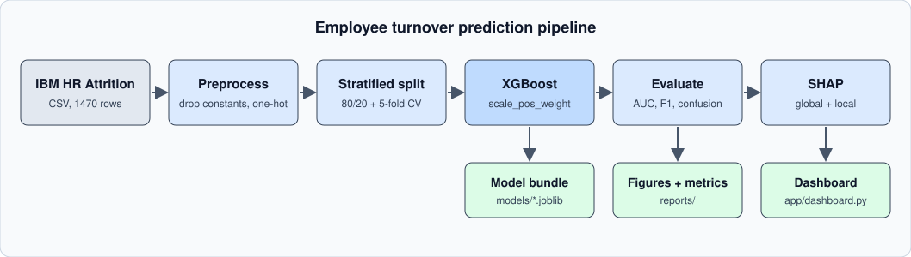
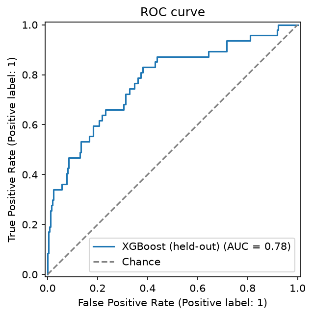
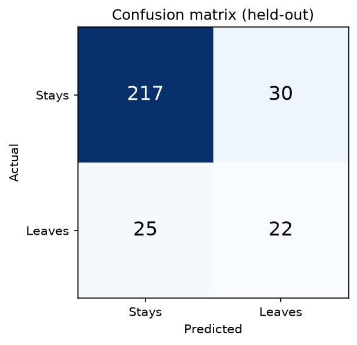
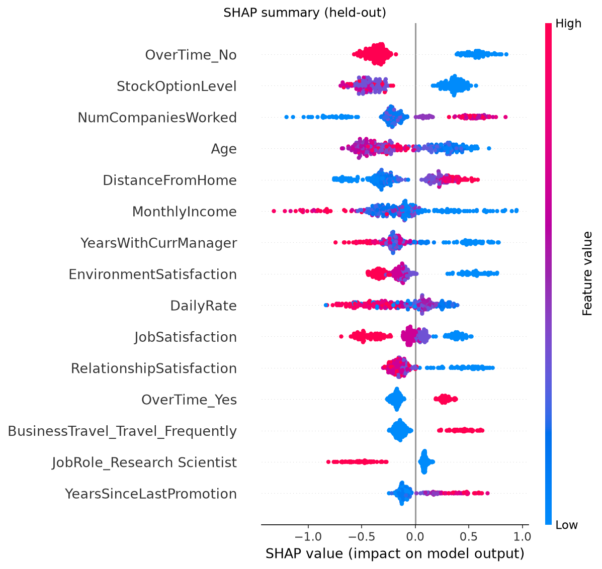
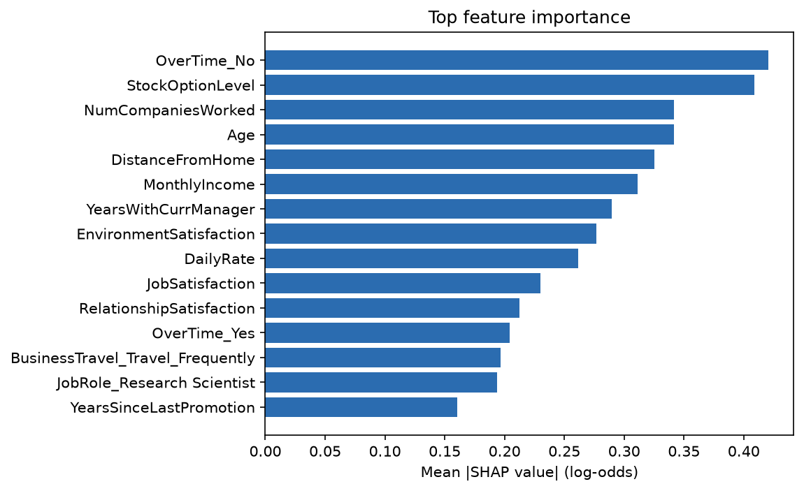

# Employee Turnover Prediction

Predict which employees are likely to leave, and explain why, with XGBoost, SHAP and a small Streamlit dashboard.


> **Note:** This is a reference re-implementation on a **public dataset**. During an AI engineering internship I built an XGBoost turnover model and a people-analytics dashboard on proprietary company data. That data and code are not part of this repository, and none of the numbers below describe that work.



## Results

Data: IBM HR Analytics Employee Attrition (1470 employees, 16.1% attrition, 51 features after one-hot encoding). 80/20 stratified split (seed 42); cross-validation runs on the 1176 training rows only, the 294 held-out rows are scored once. All numbers come from `python -m turnover.train` (see `reports/metrics.json`).

| Metric | 5-fold CV (train, mean ± std) | Held-out test (n=294) |
|---|---|---|
| Accuracy | 0.854 ± 0.016 | 0.813 |
| ROC-AUC | 0.812 ± 0.028 | 0.777 |
| F1 (leavers, threshold 0.5) | 0.541 ± 0.048 | 0.444 |

Held-out confusion matrix: 217 true negatives, 30 false positives, 25 false negatives, 22 true positives (the model finds 22 of 47 leavers).

These are modest, realistic numbers: attrition is a small, noisy minority class and the dataset is small, so the held-out estimate has wide uncertainty. No hyperparameter tuning or threshold optimisation was done.

| ROC curve | Confusion matrix |
|---|---|
|  |  |

| SHAP summary | Feature importance |
|---|---|
|  |  |

Overtime, stock option level, number of previous employers, age, commute distance and income are the main drivers. SHAP shows association learned by the model, not causation.

## Quickstart

```bash
uv venv --python 3.12 .venv
uv pip install -p .venv -r requirements.txt
uv pip install -p .venv -e .

make train            # trains, writes models/, reports/metrics.json, reports/figures/*.png
make test             # pytest, no network
make dashboard        # Streamlit app on http://localhost:8501

# score one employee (missing fields default to training medians/modes)
PYTHONPATH=src .venv/bin/python -m turnover.predict \
  --employee-json '{"Age": 27, "OverTime": "Yes", "MonthlyIncome": 2300, "JobLevel": 1, "StockOptionLevel": 0}'
```

macOS: XGBoost needs the OpenMP runtime (`brew install libomp`).

The predict command prints the probability, a risk band (low < 0.25 <= medium < 0.5 <= high) and the top SHAP drivers for that employee as JSON.

## Project structure

```
src/turnover/
  config.py       paths, seed, split and risk-band constants
  preprocess.py   loading, target, one-hot encoding to a fixed schema, class weight
  model.py        XGBoost builder, stratified CV, evaluation, bundle I/O
  explain.py      SHAP global importance and per-employee explanation
  plots.py        ROC, confusion matrix, SHAP summary, importance figures
  train.py        python -m turnover.train
  predict.py      python -m turnover.predict --employee-json ...
app/dashboard.py  Streamlit dashboard
tests/            pytest (preprocessing, small-sample training, prediction)
data/             public IBM HR Analytics CSV
reports/          metrics.json and figures produced by train.py
assets/           pipeline diagram
```

## How it works

1. **Preprocessing.** Constant columns (`EmployeeCount`, `Over18`, `StandardHours`) are dropped, `EmployeeNumber` becomes the index, categoricals are one-hot encoded. At inference the columns are re-aligned to the training schema (unseen categories are dropped, missing dummies set to 0).
2. **Imbalance.** Only 16% of employees left, so XGBoost uses `scale_pos_weight = negatives / positives` computed on the training split. No resampling.
3. **Training and validation.** Shallow trees (depth 3, 300 estimators, learning rate 0.05, subsampling) to limit overfitting on 1.2k rows. Stratified 5-fold CV on the training split, then one evaluation on the held-out split.
4. **Explanations.** SHAP `TreeExplainer` gives global importance (mean absolute SHAP) and per-employee contributions in log-odds.
5. **Dashboard.** Shows the risk distribution, top global drivers and a per-employee explanation, on the held-out set by default (the "all employees" option includes rows the model was trained on).

## What I'd do next

- Tune hyperparameters with nested CV and choose the decision threshold from a cost trade-off (cost of a missed leaver vs a wasted retention conversation) instead of 0.5.
- Calibrate probabilities and report calibration curves.
- Compare against a logistic regression baseline and a leakage-free time-based split on data that has timestamps.
- Review fairness across gender, age and marital status before any real-world use. Predicting individual attrition has real ethical risks and should drive support, not penalties.
- Package the dashboard for deployment and add CI.

## Data and licence

Data: the IBM HR Analytics Employee Attrition & Performance sample dataset, a fictional dataset created by IBM data scientists and widely distributed (for example on Kaggle). The copy in `data/` was downloaded from https://raw.githubusercontent.com/nelson-wu/employee-attrition-ml/master/WA_Fn-UseC_-HR-Employee-Attrition.csv (the file only had a BOM and CRLF line endings stripped). It is third-party data; I have not found an explicit licence in the file itself, so check the original source's terms before reusing it. Code is released under the MIT licence (see `LICENSE`).
